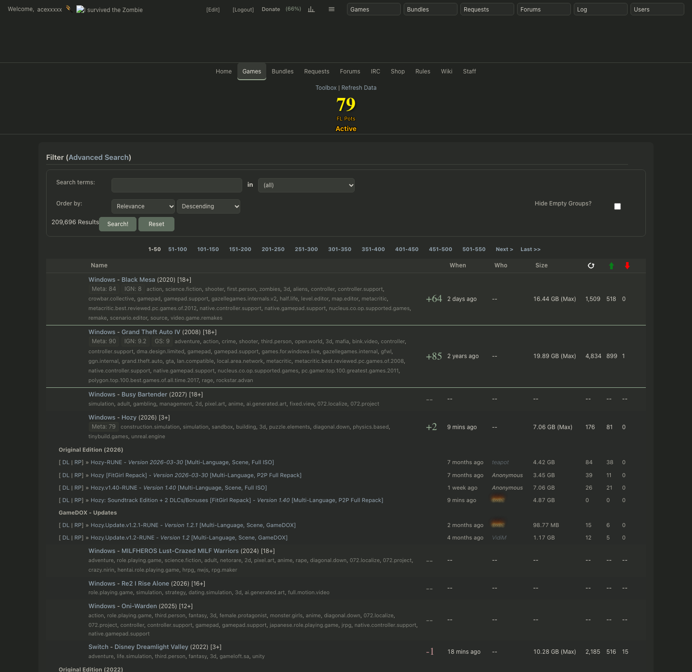

# Gazelle Dark Morandi

A dark, muted (Morandi) theme for [GazelleGames](https://gazellegames.net). No external fonts, no image requests, no JavaScript — one stylesheet.

深色莫兰迪主题。不换色，重写骨架：把站点 2009 年的绝对定位画布重建成现代布局，配色只是最后一层。



---

## 安装

站点只允许两种主题方式：默认皮肤，或者 **External CSS**。两条路都行。

### 方式 A：External CSS（推荐）

1. 打开 `https://gazellegames.net/user.php?action=settings`（Settings）
2. 找到 **External CSS** 输入框
3. 填入下面这个地址（**不要**用 `raw.githubusercontent.com`，它返回 `text/plain`，浏览器会拒绝当样式表加载）：

```
https://cdn.jsdelivr.net/gh/acesaint/ggn-morandi@main/ggn-morandi.css
```

4. 保存，刷新页面。

### 方式 B：Stylus 扩展

1. 装 [Stylus](https://add0n.com/stylus.html)
2. 新建样式 → 把本仓库的 `ggn-morandi.user.css` 全文粘进去（元信息里已写好 `@match`，只作用于 gazellegames.net）
3. 保存

> 用 External CSS 时，**必须把浏览器里其它 GGN 主题（例如 blue-night）停用**，两套样式表会互相覆盖。

---

## 配色

对比度为 WCAG 2.1 实算值（以卡片 `#292b28` 为底）。

| 用途 | 令牌 | 色值 | 对比度 |
| --- | --- | --- | --- |
| 主文字 | `--tx-0` | `#d5d2c9` | 9.45 |
| 次级文字 | `--tx-1` | `#aba99f` | 6.06 |
| 辅助（仅标签） | `--tx-2` | `#85877f` | 3.92 |
| 链接 | `--link` | `#98a9b6` | 5.91 |
| 成功 / 做种 | `--ok` | `#9bb69a` | 6.50 |
| 警告 | `--warn` | `#c2ae79` | 6.55 |
| 错误 | `--bad` | `#cb9698` | 5.68 |

表面 6 级：`#171915` 凹槽 → `#222421` 页面 → `#292b28` 卡片 → `#30322e` 卡头 → `#373a35` 控件 → `#41443e` 悬浮。
相邻只差 8–17%，层级靠 1px 线说清楚，不靠阴影。

---

## 仓库结构

```
ggn-morandi.css        发布产物：纯样式表（External CSS 用这个）
ggn-morandi.user.css   发布产物：带 UserStyle 头（Stylus 用这个）
src/                   源文件，按层拆分
  ├ 01-tokens.css      颜色 / 间距 / 字号 / 圆角 + 站点变量桥接
  ├ 02-base.css        几何中和：清掉绝对定位、固定高度、位图背景
  ├ 03-shell.css       头部三行网格、用户条、导航、搜索、内容、页脚、断点
  ├ 04-components.css  盒子、表格、表单、按钮
  ├ 05-pages.css       浏览、种子组、论坛、资料、合集、分页
  ├ 05-platform-names.css  平台页签名称映射（114 条）
  ├ 05c-store.css      商店 / 背包 / 装备 / 合成 / 交易
  └ 06-motion.css      过渡与 reduced-motion
build.py               拼接 + 静态体检（!important 预算、禁用属性、通配选择器）
publish.py             出两个成品
audit.py               静态审计：体积、特异度分布、昂贵选择器特征
```

改完源码：

```bash
python3 build.py     # 体检 + 拼到 dist/
python3 publish.py   # 生成根目录的两个成品
python3 audit.py     # 看体积与选择器特征
```

---

## 设计约束

- **零外部请求**：不用网络字体、不用第三方图标库、不加载图片。全站 3 个内联 SVG 图标。
- **配色只在一个文件里**：`src/01-tokens.css` 是唯一出现十六进制的地方。
- **`!important` 有预算**：18 处声明，每处都在源码里写了理由（站点自身用 `!important` 或者内联样式）。
- **不动 DOM、不动 JS**：只覆盖站点已有的 ID/class，不要求改任何 HTML。
- **表格行不做过渡**：几百行的列表 hover 时重绘背景是纯损耗。

## 验证

18 个页面 × 4 档视口（1440 / 1100 / 800 / 500）= **1104 项断言，0 失败**。

断言不是"看起来对不对"，而是实测的盒模型与计算样式：头部各层高度、行间不重叠、内容宽度与居中、无横向滚动、颜色真实落地、下拉面板几何、控件高度、表格单元内边距。用另存的真实页面（含真实内联样式）在 headless Chrome 里跑。

## 已知限制

- 最低只能验到 500px 宽（headless 浏览器窗口下限），375px 需真机。
- 商店/背包/装备/合成/交易五页是**位图搭的场景**（固定画布 + 绝对坐标物品格）。本主题只中和了配色与布局 bug，没有重排场景坐标。
- 消息箱未读态、灯箱、提示气泡只按站点 CSS 处理，未用真实页面验证（涉及私人内容）。

## 致谢

设计思路受 [nowtl/ggn-blue-night](https://github.com/nowtl/ggn-blue-night) 启发（色彩词表模型、立面规则、几何中和的做法），代码为独立重写；平台名称映射表取自该项目的实测结果。

## License

MIT
